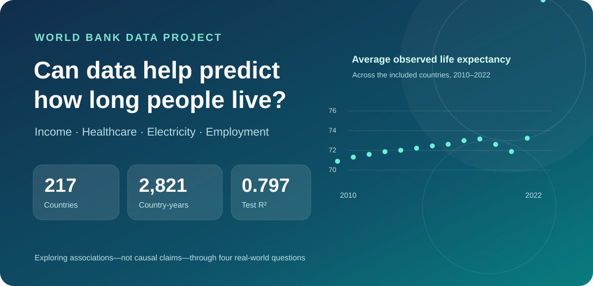
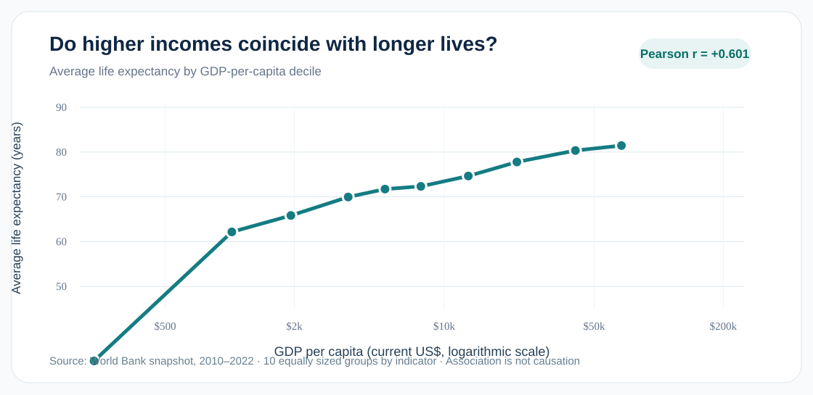
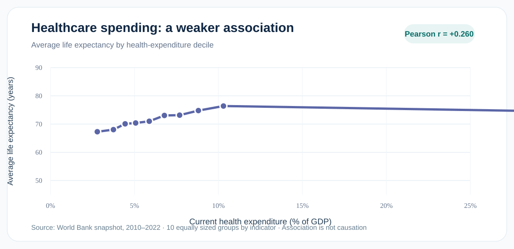
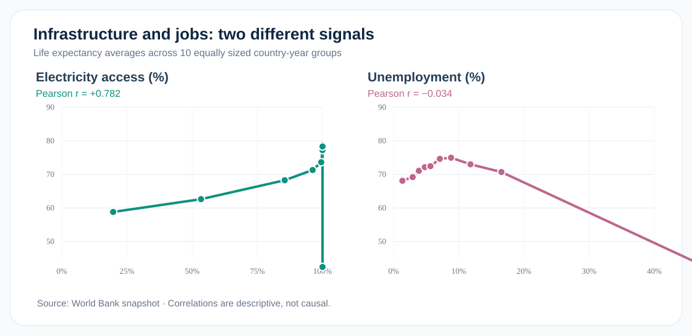
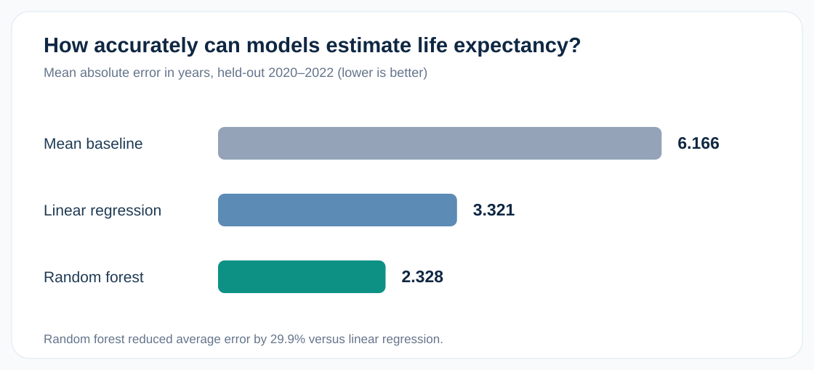

# Can a Country's Economy Predict How Long People Live?

*What 217 countries and economies, four socioeconomic indicators, and three prediction models can tell us—and what they cannot.*

**October 2026 · Data science project · Estimated reading time: 6 minutes**

Why do people live longer in some countries than others? Could economic conditions or access to basic services provide clues? To explore these questions, I analyzed **2,821 country-year observations from 217 countries and economies** using the **World Bank World Development Indicators** for **2010–2022**.

The analysis uses four indicators: GDP per capita, healthcare expenditure as a share of GDP, access to electricity, and unemployment. I looked for descriptive patterns before using machine learning to estimate life expectancy in later years.

The result is a story told through four questions, four graphics, and a candid look at model limitations.

## 1. Do higher incomes coincide with longer lives?

*Figure 1. Each point averages life expectancy for a similarly sized group of country-year observations, ordered by GDP per capita. Income uses a logarithmic scale.*

**Answer: Generally, yes.** GDP per capita showed a **positive Pearson correlation of +0.601** with life expectancy. Higher-income groups tended to have longer life expectancies.

Income was highly uneven across observations: median GDP per capita was about **$6,730**, compared with an average of about **$18,445**. The income–longevity relationship should not be assumed to be constant at every income level.

Crucially, this is a relationship in observational data. It does not prove that raising GDP directly causes longer lives.

## 2. Does spending more of GDP on healthcare mean people live longer?

*Figure 2. Average life expectancy within deciles of healthcare spending as a percentage of GDP.*

**Answer: There is a positive association, but it is weaker.** Healthcare spending as a percentage of GDP had a correlation of **+0.260** with life expectancy.

This variable measures *how much of an economy's output is spent on healthcare*, not how much is spent per patient, how affordable care is, or how well healthcare systems work. It would be a mistake to conclude from this result that healthcare spending is unimportant.

## 3. Are electricity access and unemployment associated with life expectancy?

*Figure 3. Two indicators, two very different descriptive patterns. Points represent average life expectancy in decile groups.*

**Answer: Electricity access shows a much stronger positive relationship.** Its correlation with life expectancy was **+0.782**, the highest of the four studied indicators. Unemployment showed almost no overall linear association (**−0.034**).

| Socioeconomic indicator | Pearson correlation with life expectancy |
|---|---:|
| Access to electricity (% of population) | **+0.782** |
| GDP per capita (current US$) | +0.601 |
| Healthcare expenditure (% of GDP) | +0.260 |
| Unemployment (% of labor force) | −0.034 |

Access to reliable power can coincide with better infrastructure, but many national development factors occur together. These results describe correlations; they cannot isolate a causal effect from electricity or unemployment.

## 4. Can machine learning estimate life expectancy in future observations?

*Figure 4. Error on held-out 2020–2022 observations. Lower is better.*

**Answer: Yes, for later-year records from countries already represented in the data.** I trained three models on **2010–2019** and evaluated them on **2020–2022** without fitting the models on the test period.

| Model | Mean absolute error (years) | R² |
|---|---:|---:|
| Mean-only baseline | 6.166 | −0.004 |
| Linear regression | 3.321 | 0.664 |
| **Random forest** | **2.328** | **0.797** |

The random forest was the best of these three approaches, reducing average absolute error by about **29.9% compared with linear regression**. Its R² of **0.797** means the predictions captured roughly 79.7% of the variation in this particular test sample.

The random forest emphasized **electricity access (69.5% of its feature-importance scores)** and **GDP per capita (18.6%)**, but those importance scores are **not measures of causation** or the share of years lived.

### What happens in a hypothetical scenario?

For a hypothetical country with GDP per capita **$15,000**, healthcare spending **7% of GDP**, electricity access **100%**, and unemployment **6%**, the model estimated a life expectancy of **76.77 years**. This is a demonstration of how the model responds to an input scenario—not a prediction that can be guaranteed for a real country.

## An unexpected data-quality warning

Some observations were unusually volatile. An exploratory check found **10 country-year records** with changes above 10 years from the preceding observation in the same country. Among them, a **Central African Republic 2022 observation of 18.818 years** led to the largest model error, around **36.35 years**. The recorded value also appears in the [World Bank-sourced FRED series](https://fred.stlouisfed.org/series/SPDYNLE00INCAF); it deserves additional cross-source review rather than automatic deletion.

Three of the flagged observations occurred in the 651-row test set. Excluding those **only as a sensitivity analysis** lowered MAE from **2.328 to 2.252** and increased R² from **0.797 to 0.818**. Because the flagging used actual outcomes, the original full-test metrics remain the primary evaluation.

## What should we take away?

The clearest associations in this dataset were with **access to electricity** and **income per person**. Machine learning helped summarize these patterns and predict later records, but important limitations remain:

- Countries appear in both training and test periods; prediction accuracy for completely unseen countries was **not** measured.
- The test period includes 2020–2022, when global health disruptions may have affected outcomes.
- Important factors such as education, conflict, sanitation, and the quality of healthcare were not included in these four predictors.
- Correlation and feature importance cannot establish causal mechanisms.

The lesson is not that a few indicators explain life expectancy by themselves. It is that transparent analysis can help ask better questions—provided that we communicate uncertainty, data quality, and the limits of prediction.

---

**Data and methods:** [World Bank World Development Indicators](https://data.worldbank.org/) · [Complete notebook, reproducible CSV and README on GitHub](https://github.com/luro7/World-Bank-Life-Expectancy-Prediction) · 2010–2022 country-year data. All reported correlations are descriptive and observational.
