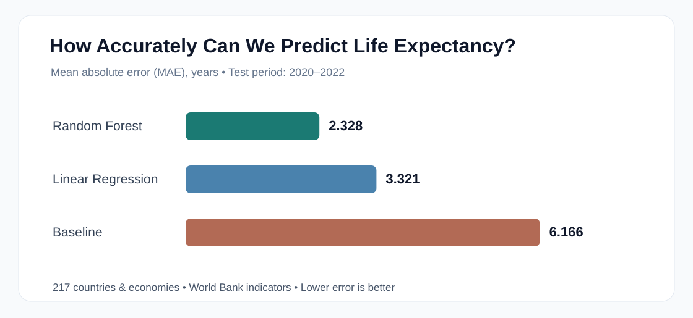

# Can a Country's Economy Predict How Long People Live?

*What data from 217 countries reveal about life expectancy—and what a machine-learning model can (and cannot) tell us.*

What helps explain why people in some countries live longer than in others? Wealth and access to essential services are obvious candidates, but the data offer a useful way to compare their relationships with life expectancy.

I explored **2,821 observations from 217 countries and economies**, covering **2010 to 2022**, using data from the [World Bank](https://data.worldbank.org/). The goal was simple: look for patterns between life expectancy and four indicators, then see whether those patterns could help predict life expectancy in later years.

## Which factors are most closely associated with life expectancy?

Among the four indicators I examined, **access to electricity** had the strongest positive statistical relationship with life expectancy. **GDP per capita** came next.

| Indicator | Correlation with life expectancy |
|---|---:|
| Access to electricity | +0.782 |
| GDP per capita | +0.601 |
| Healthcare spending (% of GDP) | +0.260 |
| Unemployment rate | -0.034 |

Correlations range from -1 to +1. Positive values mean the two measures tend to increase together; a value close to zero means little *linear* relationship was observed.

Electricity access is linked to many practical aspects of daily life—from reliable lighting to the operation of hospitals and clinics. Yet **these numbers do not prove that expanding electricity access by itself causes life expectancy to rise**. Many aspects of development are intertwined.

Healthcare spending showed a weaker relationship than I initially expected. One possible reason is that *spending as a percentage of GDP* is not the same thing as spending per person—or as healthcare quality and accessibility.

## Can a machine predict life expectancy?

To explore this question, I compared three approaches: a simple baseline that predicts the average, a linear regression model, and a random forest model. They learned from observations from **2010–2019** and were evaluated on **2020–2022**.

The most intuitive score is **mean absolute error (MAE)**: how many years away, on average, the predictions are from the recorded values.

| Approach | Average prediction error |
|---|---:|
| Simple average | 6.17 years |
| Linear regression | 3.32 years |
| **Random forest** | **2.33 years** |

The random forest model performed best, with about **30% lower average error** than linear regression. It also achieved an **R² of 0.797** on the test data, indicating that it accounted for roughly **80% of the variation** in those recorded outcomes.

This is encouraging, but it doesn't mean every prediction is accurate to within two years. Averages can hide some very large individual errors.

## What would the model predict for a hypothetical country?

Imagine a country with:

- **$15,000** GDP per person
- Healthcare spending equal to **7% of GDP**
- **100%** access to electricity
- **6%** unemployment

For this imaginary scenario, the random forest predicted **76.77 years** of life expectancy.

That result is a demonstration of what the model has learned from historical patterns—not a prediction for a real country or evidence that changing any single input would directly change how long people live.

## An important warning in the data

The analysis surfaced **10 observations** with unusually large changes in reported life expectancy between consecutive years. For instance, the World Bank–sourced series records **18.818 years for the Central African Republic in 2022**, far below adjacent years and substantially different from estimates published by other health-data providers. That case was also the model's largest error: approximately **36.35 years**. These records deserve further investigation, not automatic deletion. [World Bank series via FRED](https://fred.stlouisfed.org/series/SPDYNLE00INCAF) · [WHO country profile](https://www.who.int/data/gho/data/countries/country-details/GHO/central-african-republic?countryProfileId=134de201-66b)

### Does one unusual record change the overall result?

I checked how sensitive the evaluation was to unusually large year-to-year changes in reported life expectancy. **Three of the 651 test observations** met the review rule. When I calculated the scores on the remaining 648, the average error shifted from **2.33 to 2.25 years**, and R² rose from **0.797 to 0.818**. This was a diagnostic check using the recorded outcomes, **not** a new independent accuracy test. The original 651-observation results remain the headline numbers.

## What did I learn?

Three findings stood out:

1. **Electricity access and GDP per capita** had the clearest positive relationships with life expectancy among the indicators tested.
2. A **random forest model** could estimate recorded life expectancy considerably more accurately than a simple average or a linear regression in the later-year test data.
3. **Data quality and context matter.** Large discrepancies, possible revisions, and differences between statistical sources can change how trustworthy an apparently strong model really is.

The broader lesson is that machine learning can reveal informative patterns, but understanding *what the data mean* is just as important as obtaining a strong model score.

---

*Data source: World Bank World Development Indicators, 2010–2022. All numerical results above come from this project's analysis. Observational correlations and model feature importance should not be interpreted as causal findings.*